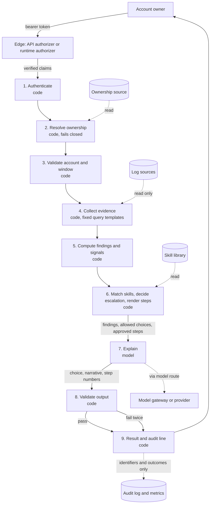

# Architecture and data flows

How a request moves, where trust changes, and what each component may do. Current state is in
[`STATUS.md`](STATUS.md): everything here has been exercised with generated data and scripted stand-ins only.

## Data flow

## Trust boundaries

| Boundary | What crosses it | Control |
|----------|-----------------|---------|
| Caller to edge | A bearer token and a typed request, or a sentence in agent mode | Token verified at the edge and again in the application. Identity is never read from the request body, a prompt or model output |
| Application to ownership source | Caller identifier | Read only. Any error, an empty answer or stale data denies the request |
| Application to log sources | One account name and a time window in a fixed template, plus one aggregate count per source that names no account | Scope re-checked inside every read. Operator settings validated as identifiers. Row, time and window caps. Time bounds sent as parameters |
| Log content to model | Counts, codes, validated host names and addresses | Raw rows never reach the model. Text that is not a valid host name or address is replaced |
| Application to model | Findings, allowed skill choices, approved step lists | One route setting. Token, time and attempt limits. The model has no tools that fetch data |
| Model to caller | A skill choice, a narrative, step numbers | Schema, allowed-choice, entity, number, time and unsafe-content checks. Steps and the escalation flag come from code |
| Application to logs | Audit line and metric line | Identifiers and outcomes only. No raw rows, no narrative |

## Components and what each may do

| Component | File | May | May not |
|-----------|------|-----|---------|
| Entry points | `src/handler.py`, `agent/app.py` | Verify identity, route to the pipeline, render results | Take identity from anywhere but verified claims |
| Scope | `src/scope.py` | Read ownership, deny | Infer ownership, fall back to a cache when the source fails |
| Evidence | `src/evidence.py`, `src/backends.py`, `src/querypack.py` | Run three fixed read queries for one in-scope account | Accept free-text queries, write anything |
| Findings | `src/findings.py` | Count, time, classify codes | Call a model |
| Skill matching | `src/skillmatch.py` | Decide eligibility, mandatory escalation, render approved steps | Be overridden by model output |
| Explanation | `src/explain.py`, `src/modelroute.py` | Ask the model to pick an allowed skill and write a narrative | Give the model tools, raw rows or other accounts |
| Validation | `src/validator.py` | Reject output, force facts only | Repair or rewrite model text |
| Routing model, agent mode only | `agent/app.py` | Choose one of two typed tools | Answer the user, see results, call a tool twice |

## Interfaces

- **Function behind an HTTP API:** `GET /accounts`, `POST /investigations` with `{"account", "window_hours", "end"}`.
- **Agent runtime:** `{"action": "list_accounts"}`, `{"action": "investigate", ...}` or `{"prompt": "..."}`.
- **Response contract:** [`schemas/result.schema.json`](../schemas/result.schema.json). `tests/test_contract.py` checks
  every golden case and every denial against it. A front end can render `facts` and `must_escalate` without a
  model answer, and should treat `report.narrative` as the only model-written field.

## Two deployment shapes, one pipeline

| | Function behind an HTTP API | Managed agent runtime |
|---|---|---|
| Fits when | A typed request from a page or another service is enough | The organization's standard path is an agent framework on a managed runtime, or free-text requests are wanted |
| Model calls per investigation | One, two at most | The same, plus one small routing call for free-text requests |
| Evidence so far | Deployed once to a sandbox on an early build | Unit tests with a scripted model |

The pipeline, skills, validator, tests and gates are shared. Choosing a shape is an owner decision, not a code change.

## Failure behavior

| Failure | Result |
|---------|--------|
| No verified identity | Denied, 401 |
| Ownership source down, empty or stale | Denied, nothing read |
| A log source fails | Investigation continues, the gap is reported, confidence drops |
| Model unavailable, blocked or over its limits | Facts and escalation flag returned, no summary |
| Model output fails validation twice | Facts and escalation flag returned, no summary |
| Operator kill switch off | Every request denied before identity, data or model |
